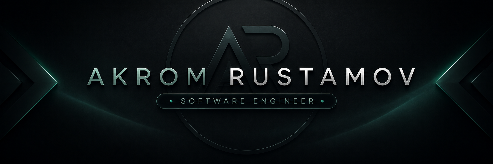

<!-- ========================= -->
<!--        HEADER BANNER      -->
<!-- ========================= -->

  

 

<!-- ========================= -->
<!--      SOCIAL LINKS         -->
<!-- ========================= -->

<h2 align="center">Explore more about me</h2>

  
  
  

 

<!-- ========================= -->
<!--         TROPHIES          -->
<!-- ========================= -->

  

 

<!-- ========================= -->
<!--      VISITOR COUNTER      -->
<!-- ========================= -->

  
   
  
    welcome to my developer universe
  

